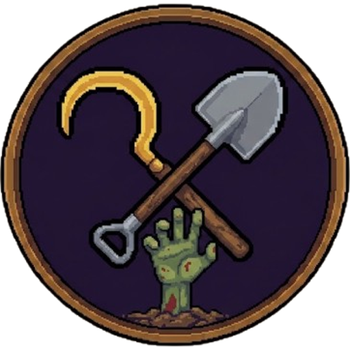

# Night Harvest 🌾⚔️

A 2D top-down farming and survival adventure game built with **Godot Engine 4**.
Farm by day, defend your crops from zombies by night.

## 🎮 Download & Play
1. Go to the [**Releases**](https://github.com/lilzamdev/Night-Harvest/releases/latest) page.
2. Download **`NightHarvest-<version>-windows.zip`**.
3. Unzip it anywhere and run **`NightHarvest.exe`** (keep `NightHarvest.pck` in the same folder).

Already playing? Open **Settings › Updates** in the game to update without reinstalling. Your saves are kept.

## ✨ Features
- **Farming System**: Till soil, plant crops, water, monitor growth cycles, and harvest produce.
- **Interactive Resource Gathering**: Chop trees with the axe to gather wood logs, featuring responsive hit shakes and drop animations.
- **Day & Night Cycle**: Dynamic lighting transitions, torch illumination, and nighttime survival.
- **Inventory & Hotbar**: Full item database, hotbar switching, eating/restoring mechanics, and chest storage.
- **Village & Livestock**: Custom animated player (Ken), wandering livestock, and quest progression.
- **Combat System**: Nighttime defense against zombie waves with weapon mechanics.

## 🆕 Version 1.4.3
- **Ripe wheat is visible again**: wheat grows from seed to green shoots to golden ripe wheat.
- **Animals feel alive when standing still**: they breathe, graze, peck, hop and look around instead of freezing.
- **No more rocks inside trees**: rocks, berry bushes and mushrooms no longer spawn under tree canopies.
- **Doors and gates work from both sides**: open and close them from behind, too.
- **New logo** on the game icon and the main menu.
- Full list: [CHANGELOG_v1.4.3.md](CHANGELOG_v1.4.3.md).

## Version 1.4 — "Seasons & Seas"
- **Four seasons** (5 days each) that change the whole world — summer gold, fall leaves, winter snow and frozen lakes — and **weather you feel**: cold, heat, mud and deep snow.
- **Oceans and islands**, and a **rowing boat** to sail there. **Fishing** from the shore or the boat, with river, snow and sea fish.
- **Villages and ruins** out in the wild — traders, street lamps, rare treasure — built from the land they stand on.
- **Biome blocks** (sandstone, ice, mossy stone, driftwood, pine), **29 decorations**, a reorganised **workbench with search**.
- **Animals** to hunt and breed, **saplings** to plant, **flowers** to pick, a real **lantern**, Harvest Village lit up at night.
- **Settings**: rebind every key, graphics and gameplay options; coordinates on the HUD and signs.
- Fixes: seeds no longer turn into green blocks, no old-map flash on new game, no crash on restart, watch-tower zoom, walking speed.
- Full list: [CHANGELOG_v1.4.md](CHANGELOG_v1.4.md).

## Version 1.3 — "The Endless World"
- **An endless, randomly generated world** (seeded): plains, forests, deserts, snow, rocky highlands, lakes and rivers. Harvest Village is now a village in the middle of it.
- **Survival & Creative** modes: start from nothing in Survival — punch trees, craft, build; Creative gives you every item (press C).
- **Build your own house**: wood/stone/brick walls and floors, doors, fences, chests, beds, a watch tower; wooden floors over water make bridges. Sleep in a bed to set your respawn.
- **Crafting from scratch**: hand crafting (C), workbench, furnace and anvil, a wood → crystal tool ladder.
- Zombies come for you anywhere at night; **two surface bosses** — the Rotting Giant and the Plague Mother.
- Controls: C crafting · 1-8 / wheel hotbar · LEFT CLICK / SPACE use & place · E interact · F inventory · Q drop · M map.
- Full list: [CHANGELOG_v1.3.md](CHANGELOG_v1.3.md).

## Version 1.2 — "The Hollow Below"
- **The Hollow Mines**: a randomly generated underground dimension under the north-east quarry. Ores, cave monsters, ladders, mine lifts and a boss.
- **Crafting** at the workbench and Ben's anvil: copper → steel → gold → crystal gear, stone walls, iron spikes, lantern posts, **sprinklers**.
- **A living world**: animated water, wind in the trees, weather (rain waters crops, thunderstorms, fog), butterflies, birds, fish, fireflies.
- **Game feel**: screen shake, hit-stop, damage numbers, bouncing item drops that fly to you, trees that topple.
- **Quest board** with town requests and reputation, and a five-chapter story that ends with the Hollow King.
- Four new crops (moonflowers only grow at night), the Bloater zombie, and you can now farm on any grass.
- Full list: [CHANGELOG_v1.2.md](CHANGELOG_v1.2.md).

## Version 1.1
- **Choose your farmer**: Ken, Mira or Rico, each with a perk.
- **Enterable houses**, villagers with schedules and dialogue, a market stall and a haunted cemetery.
- **Shop** (buy & sell), **farm defenses** (barricades, spike traps, scarecrow crossbows).
- **Harder every night**: runners, brutes and a Blood Moon every 7th night, plus a dawn report.
- **Tutorial** for new players (skippable), background **music** and gameplay **sound effects**.
- **In-game updates** from Settings › Updates; saves are kept. See [UPDATES.md](UPDATES.md).
- Full list: [CHANGELOG_v1.1.md](CHANGELOG_v1.1.md).

## ⌨️ Controls
WASD move · LEFT CLICK / SPACE use & place · 1-8 / wheel hotbar · E interact · F inventory · C crafting · Q drop · M map · ESC menu
(All keys can be changed in **Settings › Controls**.)

## 👥 Contributors & Credits
- **[limbrasonadev](https://github.com/limbrasonadev)** - Project Owner & Gameplay Systems
- **[thordyydev](https://github.com/thordyydev)** - Environmental Objects, Collision Architecture & Palette Harmonization

---
Built with ❤️ using Godot 4.
